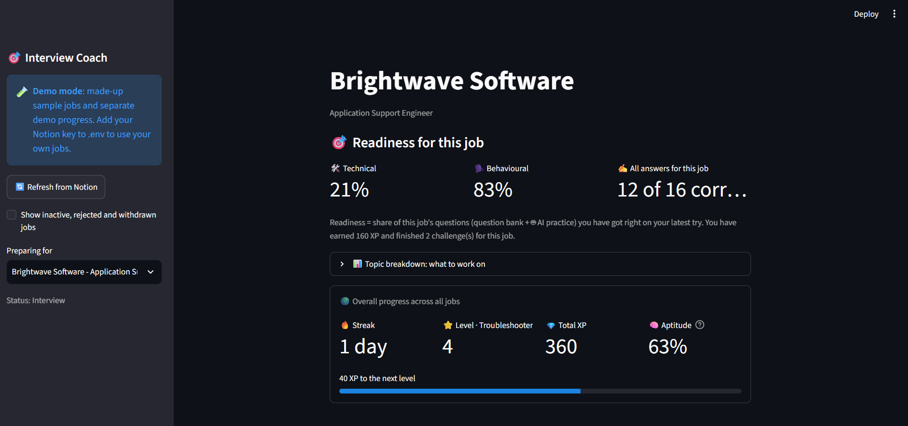
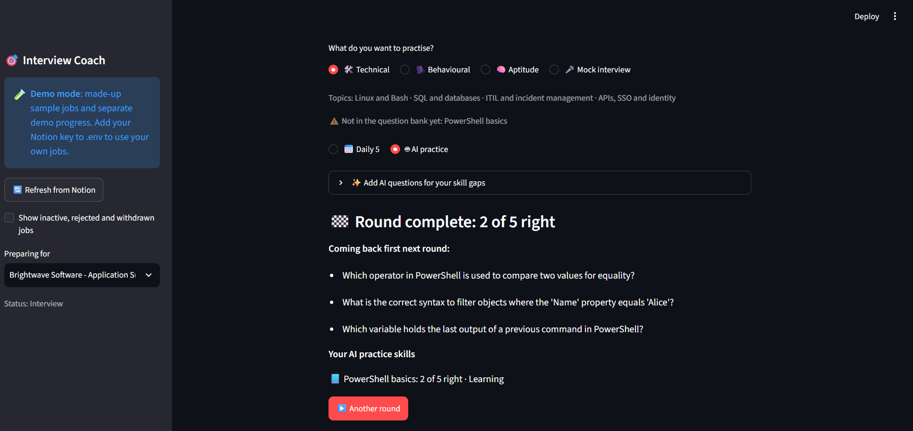
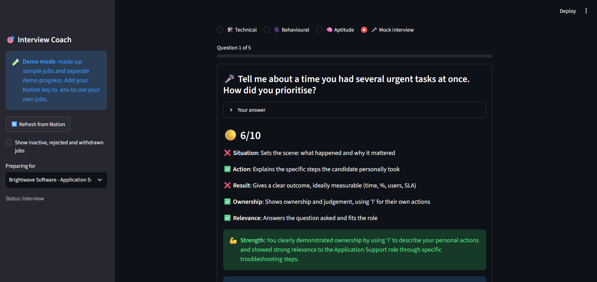
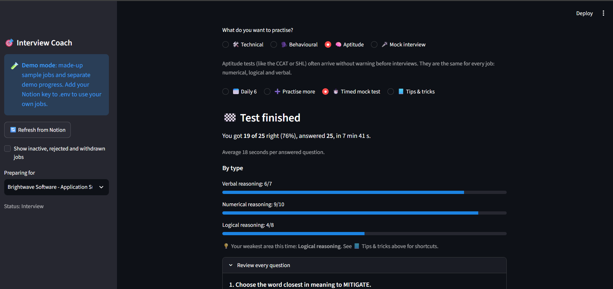
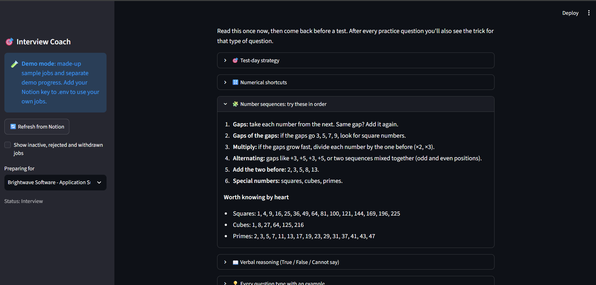
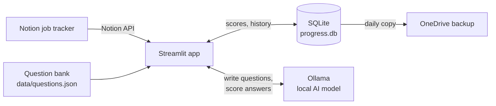

# 🎯 Interview Coach

[](https://github.com/naseem-ie/Interview-Coach/actions/workflows/tests.yml)


**A free, private interview-prep app that reads your job applications from Notion and builds daily practice for each role: quizzes, aptitude tests, AI-written questions and mock interviews scored by a local AI.**

I built this while job hunting for application support and implementation roles in Ireland. I was tracking applications in Notion but preparing for interviews somewhere else, with no way to tell how ready I was for a *specific* job. Interview Coach connects the two: each job's skill gaps in Notion decide what you practise, and the app tracks your readiness per job.



---

## ✨ Features

| | What it does |
|---|---|
| 🔗 **Reads your Notion job tracker** | Every application, recruiter chat and "to apply" job in one list. Pick a job, see its description, update its status back in Notion. |
| 🎯 **Per-job readiness** | Technical and behavioural readiness % for the selected job, with a topic-by-topic breakdown of what to work on. |
| 📅 **Daily challenges** | 5 questions a day per job, picked from a reviewed bank of 86 questions on 17 topics. Spaced repetition brings back questions you got wrong. |
| 🤖 **AI practice for skill gaps** | When a job needs a skill the bank doesn't cover (say, PowerShell or PRINCE2), a local AI writes practice questions for it. Bad questions can be removed in one click. |
| 🎤 **Mock interviews** | Open behavioural and job-specific questions. Type your answer and get a score out of 10 against a STAR checklist, a strength and two tips. Past interviews are saved to re-read. |
| 🧠 **Aptitude tests** | Numerical, logical and verbal reasoning: a daily set, unlimited practice, timed CCAT- and SHL-style mock tests, and a tips & tricks guide. |
| 🔥 **Gamified progress** | XP, 10 levels, a daily streak and aptitude accuracy across all jobs. |
| 💾 **Backup & export** | Automatic daily backup to OneDrive, plus CSV export of every answer and interview. |

## 📸 Screenshots

| AI practice for uncovered skill gaps | Mock interview feedback |
|---|---|
|  |  |

| Timed aptitude test with results by type | Aptitude tips & tricks |
|---|---|
|  |  |

*Screenshots use demo mode with made-up sample jobs.*

## 🧭 How it works



1. **Notion → topics.** Each job's *Skill gaps* text is matched against topic keywords (for example "Dynatrace" → Monitoring). Gaps that no topic covers go to the AI.
2. **Practice → progress.** Every answer is saved in SQLite. Readiness is the share of a job's questions you got right on your latest try, so it goes down again if you forget something.
3. **AI → feedback.** The local model only says yes or no to each checklist item (situation, action, result, ownership, relevance). The **code** turns that into the score, so the same answer always gets the same score.

## 🛠️ Tech stack

| Area | Tools |
|---|---|
| Language | Python 3.11 |
| UI | Streamlit |
| Data | Notion API (`notion-client`), SQLite |
| AI | Ollama running `qwen3.5:4b` locally (CPU only, no GPU needed) |
| Testing | pytest: 198 tests, using fake Notion and fake AI clients so they run in about a second |
| CI | GitHub Actions runs every test on every push |

## 🔒 Privacy and cost

- **€0 to run.** No paid APIs or subscriptions. The AI model runs on your own laptop.
- **Your answers never leave your machine.** Interview answers are scored locally, not sent to a cloud AI.
- **No secrets in the repo.** The Notion key lives in `.env`, which Git ignores. `progress.db` (your personal scores) is ignored too, and this public repo contains sample data only.
- **Least-privilege Notion access.** The Notion connection can read pages and update content only. The app only ever changes a job's *Status*.

## 🚀 Getting started

### 1. Install

```bash
git clone https://github.com/naseem-ie/Interview-Coach.git
cd Interview-Coach
python -m venv .venv
.venv\Scripts\Activate.ps1        # Windows PowerShell (macOS/Linux: source .venv/bin/activate)
python -m pip install -r requirements.txt
```

### 2. Try it in demo mode (no Notion needed)

```bash
python -m streamlit run app.py
```

With no Notion key set, the app starts in **demo mode** with made-up sample jobs. Demo progress is saved in a separate `demo.db`. If you have a Notion key but still want the demo, add `DEMO_MODE=1` to `.env`.

### 3. Turn on the AI features (optional)

1. Install [Ollama](https://ollama.com/download) (free).
2. Download the model, about 3.3 GB: `ollama pull qwen3.5:4b`

Quizzes and aptitude tests work without it. AI practice and mock interviews need it. To use a different model, set `OLLAMA_MODEL` in `.env`.

### 4. Connect your own Notion job tracker (optional)

1. Create a Notion database with these columns. The app reads whichever ones exist; **Company**, **Role**, **Status** and **Skill gaps** matter most.

   | Column | Type | Used for |
   |---|---|---|
   | Company | Title | Job list |
   | Role | Text | Job list, mock interview questions |
   | Status | Select | Hiding closed jobs, updating status |
   | Skill gaps | Text, separated by `;` | Choosing topics and AI questions |
   | Next action, Notes, Recruiter, Salary | Text | Job details |
   | Applied date, Follow-up due | Date | Job details |
   | Job link, Prep page | URL | Buttons in the app |
   | Match score | Number | Job details |

2. Paste each job advert into the job's Notion page. The app shows it under *About this job*.
3. Create a connection at [notion.so/profile/integrations](https://www.notion.so/profile/integrations) with **Read content** and **Update content**, then share the database with it.
4. Copy `.env.example` to `.env` and fill in:

   ```
   NOTION_API_KEY=ntn_...
   NOTION_DATABASE_ID=your-database-id
   ```

### 5. Run the tests

```bash
python -m pytest -q
```

## 📁 Project structure

```
app.py               Main Streamlit page: job picker, readiness, practice modes
notion_data.py       Reads jobs and job descriptions from Notion, updates status
quiz.py              Question bank, topic matching, daily picks, spaced repetition
progress.py          SQLite: answers, XP, levels, streaks, readiness, interviews
aptitude.py          Generated numerical and logical questions, mock test formats
aptitude_page.py     Practise more, timed mock tests, tips screens
aptitude_tips.py     Tricks for each question type and the study guide
question_writer.py   Asks the local AI for multiple-choice questions and checks them
ai_practice.py       AI practice screen (rounds of 5)
coach.py             Scores interview answers with the local AI
interview.py         Builds mock interviews from the job's skill gaps
interview_page.py    Mock interview screen
backup.py            Daily backup and CSV export
demo.py              Demo mode with sample jobs
data/                questions.json (question bank), sample_jobs.json (demo data)
tests/               pytest suite
```

## 💡 Design decisions

- **Maths questions are generated by code, never by the AI.** Numerical and logical aptitude questions are built from templates with random numbers, so the answer is always correct and they never run out.
- **The AI judges, the code scores.** Asking a small model for "a score out of 10" gives inconsistent numbers. Asking it 5 yes/no questions and adding up the points in code gives repeatable scores.
- **AI thinking mode is off.** On a laptop CPU, thinking mode took about 5½ minutes per answer for the same score that takes about 45 seconds without it.
- **AI questions are written once and saved**, not regenerated on every page load. They are labelled as AI-written, and you can remove any that are wrong.
- **Readiness uses your latest try.** A topic you once got right but now get wrong counts as not ready.

## 🗺️ Roadmap

- [ ] Docker image for one-command setup
- [ ] More verbal reasoning questions
- [ ] Write prep status and best mock interview score back to Notion

---

Built by [Naseem](https://github.com/naseem-ie) as a portfolio project.
