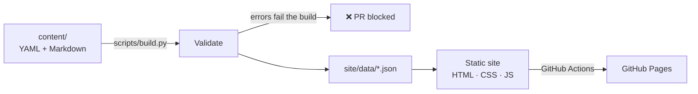

# ☁️ Cloud Prep Hub

**Free, interactive study site for the AWS Certified Cloud Practitioner (CLF-C02) exam.**
Built by two engineers returning to IT, as a hands-on project in team Git workflows, Python automation and CI/CD.

🔗 **Live site:** https://naseem-ie.github.io/cloud-prep-hub/


---

## Features

| Page | What it does |
|---|---|
| **Home** | Exam readiness score (weighted by domain), domain overview, exam facts |
| **Quiz** | Practice mode with instant explanations, or a timed exam simulation; per-domain score breakdown and answer review; retry incorrect questions |
| **Flashcards** | 3D flip cards, filter by domain, shuffle, "Got it / Still learning" tracking, keyboard shortcuts |
| **Notes** | Notes for all four domains, full-text search with highlighting, contents list with scroll-spy, completion tracking |

Also: light/dark theme, mobile-friendly layout, and progress saved in the browser (no account needed).

## How it works



1. **Content as code.** Questions and flashcards are written in YAML, notes in Markdown, so they're easy to review in a pull request.
2. **Python build pipeline.** `scripts/build.py` validates every item (4 options, a valid answer, unique ids, known domain, weights summing to 100), converts the Markdown to HTML, and writes the JSON the site loads.
3. **Automated tests.** `pytest` runs the validators against the real content and checks that they catch bad input.
4. **CI/CD.** GitHub Actions runs the tests on every pull request. Merging to `main` builds and deploys to GitHub Pages automatically.

## Tech stack

- **Front end:** HTML5, CSS3 (custom properties, grid, 3D transforms), vanilla JavaScript (ES modules)
- **Tooling:** Python 3.12, PyYAML, Markdown, pytest
- **DevOps:** Git feature-branch workflow, pull request reviews, GitHub Actions, GitHub Pages
- **Cost:** €0

## Run it locally

```bash
git clone https://github.com/naseem-ie/cloud-prep-hub.git
cd cloud-prep-hub
python -m venv .venv && source .venv/bin/activate     # Windows: .venv\Scripts\activate
pip install -r requirements.txt

pytest                                   # run the tests
python scripts/build.py                  # generate site/data/*.json
python -m http.server 8000 -d site       # open http://localhost:8000
```

## Project structure

```
cloud-prep-hub/
├── content/                 # ✍️ The study material, written by hand
│   ├── domains.yaml
│   ├── flashcards.yaml
│   ├── questions/           # one YAML file per exam domain
│   └── notes/               # one Markdown file per exam domain
├── scripts/build.py         # 🐍 Validates content and generates JSON
├── tests/test_content.py    # ✅ pytest suite
├── site/                    # 🌐 The website GitHub Pages serves
│   ├── index.html  quiz.html  flashcards.html  notes.html
│   ├── css/style.css
│   ├── js/                  # app.js (shared) + one module per page
│   └── data/                # generated by the build (not committed)
├── .github/
│   ├── workflows/ci-cd.yml  # 🚀 Test → build → deploy
│   └── pull_request_template.md
└── CONTRIBUTING.md          # How we branch, commit and review
```

## Team workflow

We never push directly to `main`. Every change is a branch, a pull request, a green CI check and a review. See [CONTRIBUTING.md](CONTRIBUTING.md).

## Disclaimer

Cloud Prep Hub is a community study resource and is not affiliated with or endorsed by Amazon Web Services. Always check the [official exam guide](https://docs.aws.amazon.com/aws-certification/latest/examguides/cloud-practitioner-02.html).
